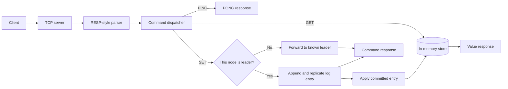

# GoCache

GoCache is an in-memory key-value store written in Go. It provides a concurrent storage engine with optional key expiration, a TCP server, and a small RESP-style protocol implementation. The project is being developed in phases, from a single-node store toward a clustered service.

## Features

- Thread-safe in-memory key-value storage
- Optional time-to-live (TTL) for keys, with background cleanup
- TCP server supporting a subset of RESP commands
- Cluster and Raft-related components under development

## Architecture

The server accepts client commands over TCP, parses RESP-style requests, and dispatches each command to the appropriate handler. Reads access the in-memory store; writes pass through the cluster manager before being applied.



## Cluster Topology

The diagrams below show the intended three-node cluster and replication layout. They are conceptual: cluster discovery, replication, and elections are experimental, and node roles and failover behavior are still under development.

### Multi-Node Cluster Network

```text
				     [ Multi-Node Cluster Network ]
							│
		     ┌─────────────────────────────┼─────────────────────────────┐
		     ▼                             ▼                             ▼
	     ┌──────────────┐              ┌──────────────┐              ┌──────────────┐
	     │ Node 1 (6379)│              │ Node 2 (6380)│              │ Node 3 (6381)│
	     │  [ Leader ]  │ ───────────► │ [ Follower ] │              │ [ Follower ] │
	     │ ──────────── │              │ ──────────── │              │ ──────────── │
	     │ Memory Map   │              │ Memory Map   │              │ Memory Map   │
	     │ TTL Janitor  │              │ TTL Janitor  │              │ TTL Janitor  │
	     └──────────────┘              └──────────────┘              └──────────────┘
		     ▲                             ▲                             ▲
		     └────────────── (Raft Heartbeats / Votes) ────────────────┘
```

Each node combines the thread-safe in-memory store with the TCP command server. The project is evolving from a standalone store toward a replicated cluster.

### Cluster Network Engine

```text
	┌──────────────┐       ┌──────────────┐       ┌──────────────┐
	│  Node 1 (Go) │ ────► │  Node 2 (Go) │ ────► │  Node 3 (Go) │
	│ [Raft/Repl]  │ ◄──── │ [Raft/Repl]  │ ◄──── │ [Raft/Repl]  │
	└──────────────┘       └──────────────┘       └──────────────┘
```

## Project Structure

```text
.
├── cmd/
│   └── server/
│       ├── main.go          # Server entry point
│       └── client/
│           └── client.go    # Small RESP client for local testing
├── internal/
│   ├── protocol/            # RESP-style command parsing
│   ├── server/              # TCP server and cluster logic
│   └── store/               # In-memory storage and TTL cleanup
├── go.mod
└── README.md
```

## Run Locally

### Prerequisites

- Go 1.25 or later

### Start a single-node server

From the repository root, run:

```powershell
go run ./cmd/server -id=node-1 -addr=127.0.0.1:6379 -peers=127.0.0.1:6379
```

Keep this terminal open. The peer list is intentionally set to this node alone so the local server can form a one-node quorum; the default peer list is intended for a three-node setup.

### Send commands

Open a second terminal at the repository root. The included client accepts a port, a command, and its arguments:

```powershell
go run ./cmd/server/client 6379 PING
go run ./cmd/server/client 6379 SET greeting "hello world"
go run ./cmd/server/client 6379 GET greeting
go run ./cmd/server/client 6379 SET temporary "expires soon" EX 10
go run ./cmd/server/client 6379 DEL greeting
```

The client prints the server's RESP response. `EX` takes a TTL in seconds. Keys without a TTL remain until deleted or the server stops; the store is in memory and does not persist its values across restarts.

## Supported Commands

| Command | Usage | Description |
| --- | --- | --- |
| `PING` | `PING` | Check that the server responds. |
| `SET` | `SET <key> <value> [EX <seconds>]` | Store a value, optionally with a TTL. |
| `GET` | `GET <key>` | Read a value. |
| `DEL` | `DEL <key>` | Delete a key. |

The protocol supports RESP arrays of bulk strings and simple text commands. It is not a complete Redis/RESP implementation.

## Development Phases

1. **Core store and TTL expiry:** Thread-safe in-memory storage and background expiration cleanup.
2. **TCP server and protocol:** Accept client connections and parse RESP-style commands.
3. **Cluster discovery and health:** Configure node identities and peer addresses, and track cluster health.
4. **Replication:** Replicate writes between a leader and followers.
5. **Raft elections and consensus:** Elect a leader and coordinate committed writes.

The clustering, replication, and consensus work is experimental and still evolving. The single-node instructions above are the recommended way to try the current server locally.